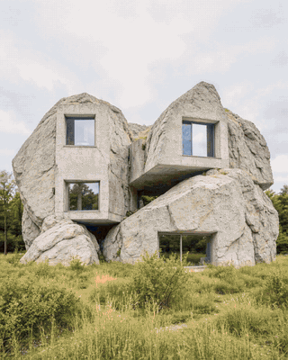
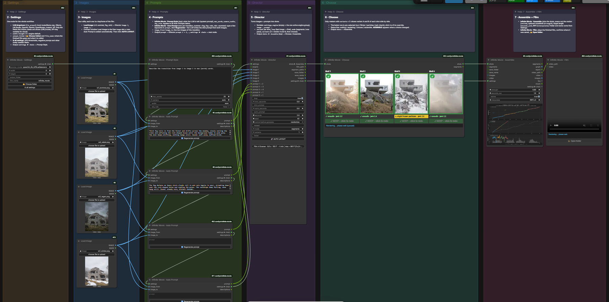
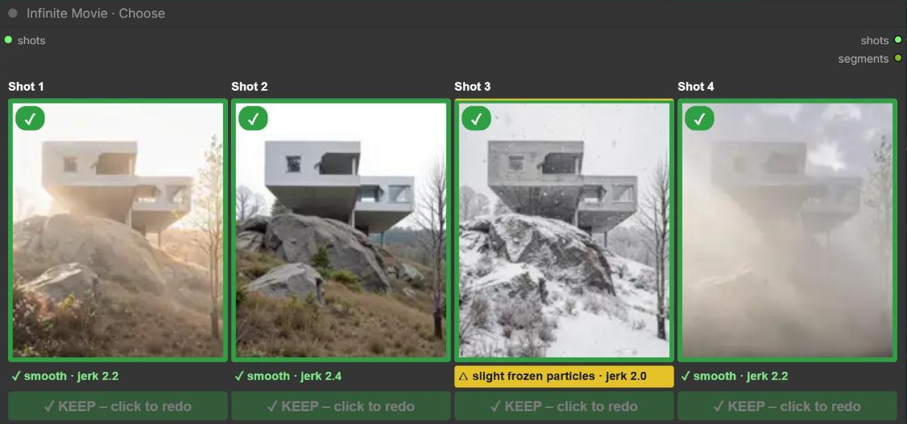

# Infinite Movie (ComfyUI)

<p align="center"></p>

<p align="center"><sub>Four stills, one LTX 2.5 render pass (737 frames, 24 fps), shown at 2x speed.</sub></p>

**Turn a few still images into one smooth, looping film.** For each pair of images a video model renders the
transition (start image → end image); the pack joins all shots into one film, evens out the motion and saves it.
A local vision model writes the prompts for you if you like. Built for a single GPU (also one shared with a local LLM).


<sub>Example workflow (four seasons): images + prompts → Director → Choose → Assemble.</sub>

## Quick start

1. **Install.** Clone this repository into `ComfyUI/custom_nodes/` and restart ComfyUI.
   Also needed: [VideoHelperSuite](https://github.com/Kosinkadink/ComfyUI-VideoHelperSuite) (brings ffmpeg).
   Optional: [ComfyUI-Frame-Interpolation](https://github.com/Fannovel16/ComfyUI-Frame-Interpolation) for RIFE.
2. **Open the workflow** `Infinite Movie` (Workflow menu › Browse Templates › *comfyui-infinite-movie*, or drag
   `example_workflows/Infinite Movie.json` onto ComfyUI).
3. **Get the models.** ComfyUI lists missing model files when the workflow opens, with a download button per file.
   Or press **📦 Check models** on the *Settings* node: it shows every missing file with its size, the total and the free
   disk space, and downloads after you confirm. ⚠ **The default engine needs about 42 GB, the prompt writer 9 GB more** –
   see [Models and download sizes](#models-and-download-sizes).
4. **Set the number of images** in Director › `images` (1–12) – Load Image nodes and their Auto Prompts are added and laid out for you. Then **load your pictures** into them (1 image works too, see [One image](#one-image)).
5. **Write the prompts.** Type a few keywords into each *Auto Prompt* and press **🔄 Regenerate prompt**, or write the
   prompt yourself.
6. **Run.** The shots render and stop at *Choose*. Look at them, keep or redo, then press **ASSEMBLE ▶** – the film
   appears in the *Film* node and in your output folder.

## The workflow at a glance

The engine sits at the top, below it one row read from left to right. Every area has a help note at its top.

| Area | What you do there |
|---|---|
| **1 · Engine** | The video model (MiniMax H3). Normally nothing to change. |
| **2 · Settings** | Prompt model, picture size, output folder, film name, sound on/off, **📦 Check models**. |
| **3 · Images** | Your stills, top to bottom = order in the film. |
| **4 · Prompts** | *Prompt Style* (how prompts are written) and one *Auto Prompt* per transition. |
| **5 · Director** | `images` (how many), the image list (drag to reorder, ✕ to remove), seconds per shot, `loop` (last image back to the first), `variants` (1 or 2 per shot). |
| **6 · Choose** | Check the shots, pick A/B, mark shots to redo, **ASSEMBLE** / **RERENDER**. |
| **7 · Assemble + Film** | Joins the shots, evens out the motion, shows and saves the film. |
| **8 · Upscale** | Optional (muted): sharper, larger film. Select the group and press Ctrl+M to turn it on. |

Settings are passed along one chain: Settings → Prompt Style → Auto Prompts → Director → Assemble.

**Node colours:** green = positive prompt, red = negative prompt, blue = model loader, cyan = engine connection
(*Engine Start* / *Engine Result*), red = help notes.

## Models and download sizes

Put the files into the folders under `ComfyUI/models/`. You only need **one** engine.

| Use | Files | Download |
|---|---|---|
| **MiniMax H3** (default engine, with sound) | 5 files | **42.0 GB** |
| Prompt writer `qwen3vl_4b_bf16` (optional: writes the prompts) | 1 file | **8.9 GB** |
| LTX 2.5 (other engine, 🔒 gated) | 4 files | 38.7 GB |
| Wan 2.2 (other engine, no sound) | 6 files | 36.9 GB |
| Upscale model (group 8) | 1 file | 0.01 GB |

**MiniMax H3**

| File | Folder | Size | Download |
|---|---|---|---|
| `minimax_h3_fl2va_pruned_int8_convrot.safetensors` | `diffusion_models` | 21.0 GB | [Comfy-Org/MiniMax-H3](https://huggingface.co/Comfy-Org/MiniMax-H3/resolve/main/diffusion_models/minimax_h3_fl2va_pruned_int8_convrot.safetensors) |
| `minimax_h3_fl2v_turbo_8step_v1.1_768p_comfyui_bf16.safetensors` | `loras` | 2.0 GB | [lightx2v/Minimax-h3-Turbo](https://huggingface.co/lightx2v/Minimax-h3-Turbo/resolve/main/minimax_h3_fl2v_turbo_8step_v1.1_768p_comfyui_bf16.safetensors) |
| `qwen3vl_32b_minimax_h3_nvfp4_awq.safetensors` | `text_encoders` | 15.7 GB | [Comfy-Org/MiniMax-H3](https://huggingface.co/Comfy-Org/MiniMax-H3/resolve/main/text_encoders/qwen3vl_32b_minimax_h3_nvfp4_awq.safetensors) |
| `minimax_h3_video_vae_int8_convrot.safetensors` | `vae` | 2.8 GB | [Comfy-Org/MiniMax-H3](https://huggingface.co/Comfy-Org/MiniMax-H3/resolve/main/vae/minimax_h3_video_vae_int8_convrot.safetensors) |
| `minimax_h3_audio_vae_fp32.safetensors` | `vae` | 0.6 GB | [Comfy-Org/MiniMax-H3](https://huggingface.co/Comfy-Org/MiniMax-H3/resolve/main/vae/minimax_h3_audio_vae_fp32.safetensors) |

**Prompt writer** (Settings › `prompt_model`; any Qwen3-VL in `text_encoders` works, `off` = write prompts yourself)

| File | Folder | Size | Download |
|---|---|---|---|
| `qwen3vl_4b_bf16.safetensors` | `text_encoders` | 8.9 GB | [Comfy-Org/Qwen3-VL](https://huggingface.co/Comfy-Org/Qwen3-VL/resolve/main/text_encoders/qwen3vl_4b_bf16.safetensors) |

The model links for LTX 2.5 and Wan 2.2 are in their engine workflows (help note) and in `models.json`.
**LTX 2.5 is gated:** accept the license on [Hugging Face](https://huggingface.co/Lightricks/LTX-2.5) first; for the
automatic download set the environment variable `HF_TOKEN` to your Hugging Face token.

## Engines

The video model is always **visible** in the workflow as an engine group:

```
Infinite Movie · Engine Start (from Director)  →  your model chain  →  Infinite Movie · Engine Result (to Director)
```

| Engine | Workflow with only this group | fps | Frame grid | Sound |
|---|---|---|---|---|
| **MiniMax H3** (default, built into *Infinite Movie*) | `Infinite Movie - Engine MiniMax H3` | 24 | 17k+5 | yes |
| LTX 2.5 | `Infinite Movie - Engine LTX 2.5` | 24 | 8n+1 | yes |
| Wan 2.2 | `Infinite Movie - Engine Wan 2.2` | 16 | 4n+1 | no |

- **Switch engine:** open the engine workflow (Templates in the left bar › *comfyui-infinite-movie*), click its group
  title and copy it (Ctrl+C), paste it into your workflow (Ctrl+V), mute the MiniMax group (click its title, Ctrl+M) and
  press **🔗 AUTO LAYOUT**. Only **one** engine group may be active; muted groups never run.
- The *Director* finds the one active *Engine Result* by itself. With several active groups, connect the wanted
  *Engine Result* to the Director's `engine` input.
- **Own engine (any video model):** easiest is to copy an engine group and swap the model nodes. From scratch:
  1. Add **Infinite Movie · Engine Start** and **Infinite Movie · Engine Result** (double-click the canvas, search "Engine").
  2. Engine Start → your model: `start_image` / `end_image` → the image-to-video (first/last frame) node, `prompt` → text
     encoder, `seed` → sampler, `width` / `height` / `length` → the video/latent size.
  3. Decoded frames (IMAGE) → Engine Result › `images` (or a VIDEO → `video`), sound → `audio`.
  4. Engine Result: `fps` = the model's fps, `length_grid` (advanced) = its frame step (Wan 4, LTX 8, H3 17).
  5. Put it in a group, mute the other engine group (Ctrl+M), press **🔗 AUTO LAYOUT**.

  There are no hidden presets – what you see is what renders.
- **MiniMax H3 group:** first/last-frame model + 8-step turbo LoRA, KSampler (8 steps, cfg 1, `res_multistep`, `simple`,
  negative = *ConditioningZeroOut*). Without the LoRA: bypass it and use 20–25 steps.
- The H3 and LTX text encoders cannot write prompts; Settings › `prompt_model` hides them.

### One image

- `loop` off: an open shot – starts on the image and runs free.
- `loop` on: **two passes** – shot 1 runs free from the image, shot 2 runs from shot 1's last frame back to the image.
  Each shot has its own prompt (shot 1: what happens, shot 2: how it returns).

### Leave images out

Lower Director › `images`: the last images and their Auto Prompts are removed; the Director remembers them (file + prompt text, saved with the workflow) – raise it again to bring them back. Or select any *Load Image* and press Ctrl+M: the Director skips it while it stays muted.

**Image order:** the Director shows the images as a list, top = first. Drag a row up or down to move an image, ✕ removes it (raising `images` brings it back at the end). Transitions whose image pair changed get an empty prompt and the button **⚠ new pair – 🔄 regenerate**; unchanged transitions keep their text. To put an image in between: raise `images`, load the picture, drag it into place.

## Sound

Settings › `audio` is **off** by default (faster, no audio model is loaded). Turn it on for engines with sound
(MiniMax H3, LTX). Assemble keeps the sound **only with `even_motion` off** – evening out changes the timing, so the film
stays silent then. Prompts can describe sound, e.g. `sound: howling wind`.

## Nodes

| Node | What it does |
|---|---|
| **Settings** | Shared settings for the whole chain: `prompt_model`, `aspect` + `long_side` (both sides rounded to 32; 4:5 + 960 = 768×960), `output_folder` (**📂 Choose folder**), `film_name`, `audio`, **📦 Check models**. GPU check on Run: if another program holds too much GPU memory, nothing is queued and a message names it – the pack never closes other programs. |
| **Story Mode (LLM)** | Optional. Plug `LLM` into Settings › `LLM` (AUTO LAYOUT does it): a bigger vision LLM then writes the prompts instead of `prompt_model` (greyed out while plugged in). It first reads **all** images and plans the film – an arc plus one beat per shot – then every Auto Prompt writes its shot from its two images and its beat. `story` = your red thread (goes into every system prompt). Both instructions are editable; **↺ Restore default prompts** brings the originals back. The plan shows in the node (**④ Plan result**). **Simple prompts:** unplug the `LLM` cable (or bypass the node) – `prompt_model` writes again. Setup: [Story Mode setup](#story-mode-setup). |
| **Prompt Style** | What the prompt model is told, `max_words`, `camera` (appended; `none` = no camera sentence). |
| **Auto Prompt** | One per transition. Looks at both images and writes the prompt from your keywords when you press **🔄 Regenerate prompt** (only this node; ~20 s with Qwen3-VL 4B). Never writes on Run: a filled prompt is used as is. |
| **Director** | 1–12 images + one prompt per transition → renders all shots. `images` sets the count: more adds Load Image nodes (copy of the last image) with Auto Prompts, fewer removes the last ones (remembered). The image list below it reorders (drag) and removes (✕) images. `seconds` per shot (snapped to the engine's frame grid), `loop`, `variants` (`2` = render A and B per shot). Rendered shots are kept: a shot is rendered again only when its seed changes (`reseed` or the base `seed`) – an edited prompt or image alone does not re-render it. Outputs `shots ▶ Assemble`, `settings ▶ chain`. Shows progress and remaining time. |
| **Engine Start / Engine Result** | Left and right edge of an engine group (see [Engines](#engines)). |
| **Choose** | One tile per shot (A above B with variants). Hover plays, click picks; **✓ KEEP / ✗ REDO** per shot. Each tile shows a check in plain words: green *✓ smooth*, yellow *△ slight flicker*, red *⚠ HARD CUT / HARD SEAM*. **✎ prompt** and **⏱ seconds** change one shot and mark it REDO. Big button: **ASSEMBLE ▶** (build the film from your picks) or **RERENDER n ↻** (only the marked shots). 3×3 contact sheet of the shot under the mouse. |
| **Assemble** | Joins the shots into the film. `even_motion` re-picks frames so each carries about the same change. `interpolate` RIFE x2 (fewer repeated frames). Runs only on **ASSEMBLE**. The film mp4 contains the prompt and the workflow. Viewer (3×3 Load-Image tiles, all tabs the same size): **Graph**, **Timeline**, **Heatmap**, **Frames** (slider, ▶, onion skin), **Particles** (motion trails), **Sheet** (3×3 … 8×8, click = open frame). Outputs `video_path`, `last_frame`, `first_frame`. |
| **Film** | Plays the finished film, shows where it was saved, **📂 Open folder**, remembers the last three films. |
| **Last Frame** | Last frame of a film – e.g. the start image of the next part. Reads frame by frame. |
| **Movie to GIF** | Film → GIF or WebP with live preview and size estimate (crop, fps, trim, speed, boomerang, palette, `max_mb`). Inputs `video / images / video_path / file` (in that priority), `every_nth` keeps every n-th frame; the GIF is saved next to the source. |
| **H3 Loop / H3 Loop Decode** | Seamless loops in one MiniMax H3 pass (end wrapped around to the start while sampling). |
| **LTX Refine / RelayVSR Upscale** | See [Upscale](#upscale). |

*(internal)* nodes are used by the engine expansion and are not meant to be placed by hand.

### Choose and variants

With Director › `variants` = `2` every shot renders twice: **A** (`seg_XXX.mp4`) and **B** (seed + 500,
`seg_XXX_b.mp4`). **Run** renders and stops at *Choose*; pick per shot, then **ASSEMBLE** – only Assemble runs.
Changing only the pick never re-renders. **RERENDER** re-seeds only the marked shots. **Cancel** removes the
half-finished film.



### Story Mode setup

The small `prompt_model` writes each shot from its two images only. For a film that tells one story, use a bigger
vision LLM through **Story Mode (LLM)**:

1. Add **Infinite Movie · Story Mode (LLM)** (it sits under Settings in the example workflow and comes **off** – purple = bypassed: click it and press **Ctrl+B** to switch it on).
2. Plug its output `LLM` into Settings › `LLM`.
3. Pick a `provider`: it fills `endpoint`, `model` and `api_key_env`. Change them freely afterwards.
4. Write your red thread into `story` (optional), then **🔄 Regenerate prompt** on the Auto Prompts. The plan
   (arc + one line per shot) appears in the node under **④ Plan result**.

**Simple prompts – back to the small model:** unplug the `LLM` cable from Settings (or bypass Story Mode with
Ctrl+B). `prompt_model` is active again and writes each shot from its two images – no server needed, nothing else to
change. Plug it back in for the next story film.

| provider | endpoint | what to run |
|---|---|---|
| local server (llama.cpp, vLLM) | `http://127.0.0.1:8080/v1` | llama.cpp: `llama-server -m <model>.gguf --mmproj <mmproj>.gguf`; vLLM: `vllm serve <model>` (then port 8000) |
| Ollama | `http://127.0.0.1:11434/v1` | `ollama pull <vision model>`; set `model` to its name (e.g. a Qwen-VL or Gemma 3 tag) |
| LM Studio | `http://127.0.0.1:1234/v1` | load a vision model, start the server (Developer tab) |
| OpenAI / Gemini / OpenRouter | filled in | an API key in the environment variable named in `api_key_env` |
| custom | your URL | anything that speaks the OpenAI chat API (`/v1/chat/completions`) |

- **The model must read images** (vision / multimodal). A text-only model answers without seeing the shots.
- **`model` empty** (local servers only) = the loaded model, else the first one the server lists.
- **API keys are never stored in the workflow** (workflows get shared). `api_key_env` holds only the *name* of an
  environment variable, e.g. `OPENAI_API_KEY`. Set it before starting ComfyUI – Windows: `setx OPENAI_API_KEY "sk-…"`
  (new console afterwards), Linux/macOS: `export OPENAI_API_KEY=sk-…`.
- **`thinking`** works on local servers whose chat template supports it (llama.cpp, vLLM); `off` is fastest.
- **GPU:** with `free_vram` (advanced, on) ComfyUI frees its own models before each question, so a local LLM has room.
  The pack never stops or unloads the LLM server itself – before a render, make sure the GPU is free (the Run check
  names the program that holds it).
- Speed, measured with a local 27B model: storyboard ~6 s per film, ~8 s per shot. The storyboard is cached until the
  images, `story` or the instruction change.
- **Errors** show in the ComfyUI console: `not reachable` = server not running or wrong port; `answered 404` = the
  endpoint lacks `/v1`; `environment variable … is not set` = see API keys above.

## Upscale

Group **8 · Upscale** (muted, Ctrl+M turns it on) in the main workflow upscales the assembled film with RelayVSR x4:

```
Assemble › video_path  →  Infinite Movie · RelayVSR Upscale (x4 → 1920, ram_gb 16)  →  Film
```

LTX Refine is no longer in the main workflow; it is the alternative in its own workflow `Upscaler/Infinite Movie - LTX Upscale` (template folder `example_workflows/Upscaler/`)
for any film:

```
VHS Load Video  →  Upscale Crop Universal (×1.3334, multiple of 64)  →  Infinite Movie · LTX Refine (1:1)
```

- **RelayVSR Upscale** (core RelayVSR x2/x4, ComfyUI ≥ 0.45): UNETLoader `relayvsr_x2_…`/`relayvsr_x4_…` + VAELoader
  `relayvsr_flash_vae_x2/x4` → this node. It cuts the film into segments that fit `ram_gb` (x4 on 768×960:
  16 GB = 46 frames per segment), upscales each one, scales it down to `longest_side` (default 1920; x4 → 1920 is the
  calmest and sharpest result) and writes it straight to the file – any film length, loops seamless, sound kept,
  saves `<name>_upscale.mp4`. Lower `ram_gb` if RAM runs out.
  Models from [Comfy-Org/RelayVSR](https://huggingface.co/Comfy-Org/RelayVSR) (no login): `relayvsr_x4_int8_convrot.safetensors`
  (5.2 GB) → `models/diffusion_models/`, `relayvsr_flash_vae_x4_fp32.safetensors` (128 MB) → `models/vae/`.
  Measured: 26 s film (624 frames, 768×960) in 3.7 min, 11.5 GB RAM peak (LTX Refine: ~10× slower).
- LTX Refine: prompt `photographic, 4k`, negative empty, sigmas `0.421875, 0.0` (higher = softer, more flicker).
- LTX Refine base upscale model: [2x-LiveActionV1-SPAN](https://openmodeldb.info/models/2x-LiveActionV1-SPAN) by jcj83429
  (CC-BY-NC-SA-4.0) – [download](https://raw.githubusercontent.com/jcj83429/upscaling/f73a3a02874360ec6ced18f8bdd8e43b5d7bba57/2xLiveActionV1_SPAN/2xLiveActionV1_SPAN_490000.pth)
  (9 MB) into `models/upscale_models/`. *Upscale Crop Universal* ships with this pack.

## Render time

Measured on an RTX 4090 (24 GB) with the default MiniMax H3 group (8-step LoRA), format 4:5. Time **per shot**; a film
adds about 40 s once (loading, RIFE x2, joining). A film with *n* images and `loop` has *n* shots (one image + `loop`: 2).

| long side (size) | 2 s | 4 s | 6 s | 8 s | 10 s |
|---|---|---|---|---|---|
| 512 (416×512) | – | 0.6 min | 0.8 min | 1.0 min | 1.3 min |
| 768 (608×768) | 0.6 min | 1.1 min | 1.4 min | 2.1 min | 2.8 min |
| 960 (768×960) | 0.8 min | 1.7 min | 2.4 min | 3.6 min | 5.0 min |
| 1152 (928×1152) | 1.3 min | 2.7 min | 3.9 min | 6.0 min | 9.3 min |
| 1344 (1088×1344) | 1.9 min | 4.2 min | 6.2 min | 9.5 min | out of memory |

Example: 4 images, `loop`, 5 s per shot at 768×960 = 9 min. Time grows faster than the pixel count (attention is
quadratic). On 24 GB, 1088×1344 is the practical limit (up to 8 s per shot). While rendering, the Director shows a
progress bar with the remaining time – from the first second on, using the durations of earlier shots **on your
machine** (stored in `ComfyUI/user/infinite_movie_timings.jsonl`), then from the shots of the running film.

Other engine groups, same machine, 768×960 per shot (warm): **LTX 2.5** distilled (8 sigmas) about 1.1 min at 2 s,
1.3 min at 5 s, 2.0 min at 8 s – faster than MiniMax from 4 s on. **Wan 2.2** (lightx2v LoRA, 4 + 4 steps, 16 fps) is
in the MiniMax range at 608×768 (0.9 min at 4 s, 3.7 min at 10 s) but loads two 14B experts, so the first shot after a
start takes about 1 min longer.

## Requirements and troubleshooting

- ComfyUI with the V3 node API, a recent frontend, an NVIDIA GPU (tested on 24 GB, up to 1088×1344).
- **ffmpeg:** comes with VideoHelperSuite (`imageio-ffmpeg`); otherwise install it
  ([Windows builds](https://www.gyan.dev/ffmpeg/builds/), [ffmpeg.org](https://ffmpeg.org/download.html)) and put it on PATH.
- **Run does not start and names another program:** that program holds too much GPU memory; close it and press Run again.
- **Silent film in VHS Load Video fails:** `python tools/patch_vhs_silent_audio.py` patches VideoHelperSuite to return
  silence (re-run after VHS updates, `--check` to test).
- **Missing model after download:** check the folder (table above) and press **R** in ComfyUI to refresh the lists.
