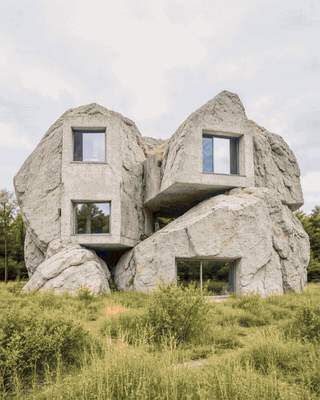
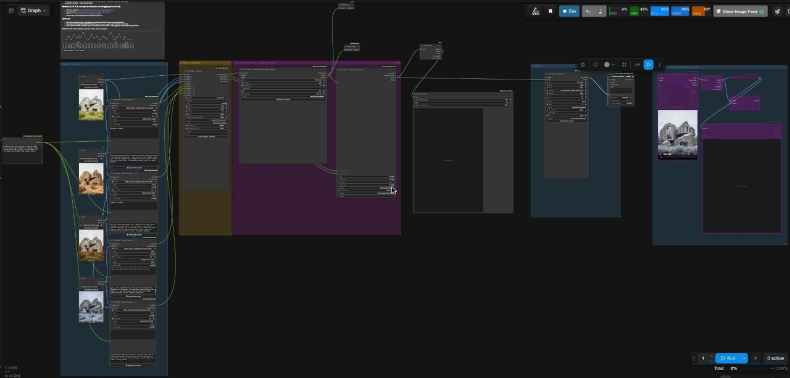

# Infinite Movie Nodes (ComfyUI)

> **Status: prototype.** This repository still holds an early snapshot. The completed version (one-pass rendering of all stills, motion normalization, review & redo of single segments, upscale) will be published here this week (week of 26 Oct 2026).

Four stills, one LTX 2.5 render pass (737 frames, 24 fps), shown at 2x speed.

ComfyUI custom nodes that turn a sequence of stills into a (looping) film:
pairwise first/last-frame video segments (LTX 2.5 / Wan 2.2 FLF2V), stitched and finished.
Built for a single GPU shared with a local LLM (VRAM handoff).

Example workflow (four seasons): images + prompts → Film Chain · Render → Normalize Time / Concat → Upscale.

| Node | Purpose |
|---|---|
| **FilmChain** | 1–12 images (dynamic inputs) + one prompt per transition → renders all segments. Length in seconds (snapped to the engine's 8n+1 frame grid). |
| **Film Auto Prompt** | Vision LLM (OpenAI-compatible endpoint) writes the transition prompt from two images. |
| **Film Concat** | Stitches the segments into one film. |
| **Film Finish (Quality / Length)** | Final scale (e.g. 1080×1350), sharpen, optional RIFE x2. |
| Film Segment Save / Film Segment Paths | Segment files and paths. |
| Frame Pair Switch | Pick image pairs from a list. |
| VRAM Acquire / VRAM Release / Memory Status | GPU handoff to/from a local LLM server, VRAM/RAM display. |

Requires ComfyUI with the V3 node API, ffmpeg (imageio_ffmpeg or on PATH); RIFE via ComfyUI-Frame-Interpolation (optional).

Install: clone into `ComfyUI/custom_nodes/` and restart ComfyUI.

Status: prototype – completion this week.
